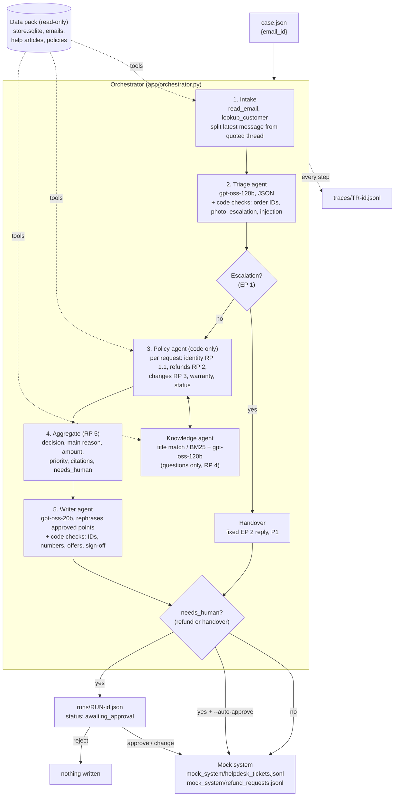

# Architecture

One email in, one decision, one reply, one ticket out. Models read and write language; code makes every
policy decision.

## Fallbacks (each agent keeps working without a model)

| Step | Normal path | If every model call fails |
| --- | --- | --- |
| Triage | gpt-oss-120b, then gpt-oss-20b, then Gemini (if a key is set) | Rule-based extractor (patterns per request type) |
| Knowledge | exact title match, else BM25 + gpt-oss-120b picks among candidates | BM25 with a strict score threshold; below it, "a specialist will reply" |
| Policy | code only | (not model-dependent) |
| Writer | gpt-oss-20b, then gpt-oss-120b, then Gemini | Template reply built from the same approved points |
| Handover | fixed template | (not model-dependent) |

A sample trace of UC4-S04 is in [sample_trace_UC4-S04.jsonl](sample_trace_UC4-S04.jsonl).
